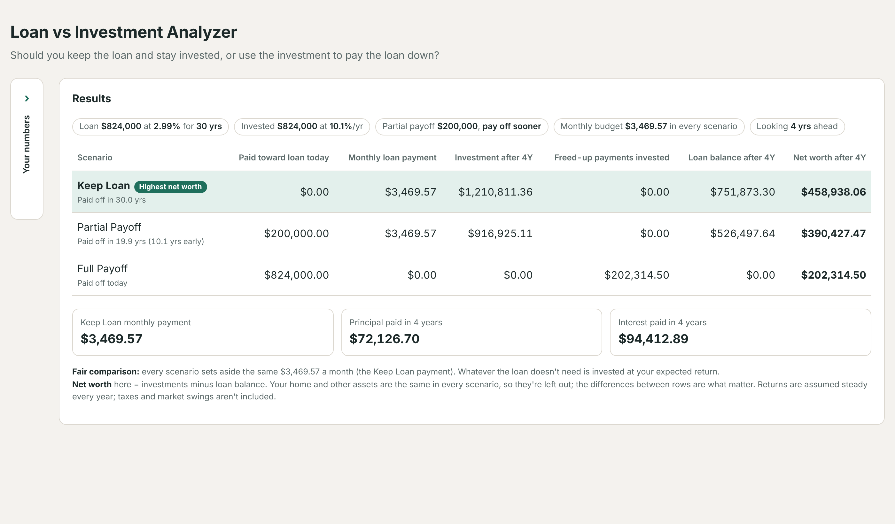

# Loan-vs-Investment-Analyzer

A small web app that compares keeping a loan and staying invested versus using the investment to pay the loan down (partially or fully), and shows the net worth of each scenario after a number of years.

**Runs on port 8070**: http://localhost:8070



## Quick Start
Get started quickly! See the [Initial Deployment Guide](docs/INITIAL_DEPLOYMENT.md).

## Documentation
- 📋 [Initial Deployment Checklist](docs/INITIAL_DEPLOYMENT.md) - Complete setup guide
- 🔄 [Update Cycle](docs/UPDATE_CYCLE.md) - How to update and redeploy

## Setup (Traditional)
1. Activate virtual environment: `venv\Scripts\activate`
2. Install dependencies: `pip install -r requirements.txt`
3. Run: `python src/main.py`
4. Open http://localhost:8070 in your browser (the port is printed in the terminal as a reminder)
5. Stop with Ctrl+C

To use a different port: `set PORT=8075` (Windows cmd) before `python src/main.py`.

## Running tests
```bat
pip install -r requirements-dev.txt
python -m pytest
```
`requirements-dev.txt` adds pytest on top of the app's packages. Tests live in `tests/` and are not copied into the Docker image.

## How the comparison works
Every scenario sets aside the same monthly budget: the Keep Loan payment. Each month the loan payment comes out of that budget and whatever is left over is invested at the expected return. So paying the loan off early is credited with the payments it frees up.

After a partial payoff you can choose **Same payment, pay off sooner** (most loans) or **Lower my payment** (only if the lender recasts the loan).

**Net worth** = investments minus loan balance. Your home and other assets are the same in every scenario, so they are left out.

## Setup (Docker)
1. Build the image: `docker build -t loan-vs-investment-analyzer .`
2. Run the container: `docker run -p 8070:8070 loan-vs-investment-analyzer`
3. Open http://localhost:8070 in your browser

## Push to Docker Hub
1. Tag: `docker tag loan-vs-investment-analyzer timothypaulschmidt/loan-vs-investment-analyzer`
2. Push: `docker push timothypaulschmidt/loan-vs-investment-analyzer`

## Project layout
| File | Job |
|---|---|
| `src/main.py` | Starts the web server and prints the port |
| `src/app.py` | Web routes: show the form, validate, run the analysis |
| `src/templates/index.html` | The HTML page |
| `src/utils/helpers.py` | Parses and validates typed numbers (`$`, commas, `%`) |
| `src/utils/loan_math.py` | Loan and investment calculations (month-by-month simulation) |
| `tests/` | pytest unit tests |

## Ports used in the home lab
| App | Port |
|---|---|
| MCP Server | 8000 |
| AI Assistant | 8080 |
| AI Agents | 30090 |
| **Loan vs Investment Analyzer** | **8070** |
